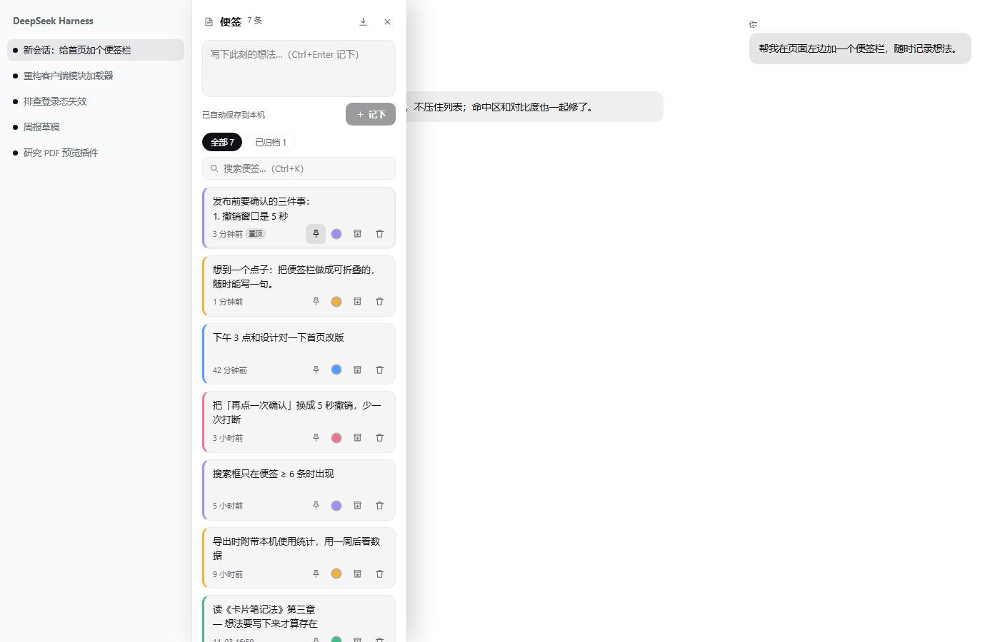

# dsh-plugins

[](https://github.com/woshiwenjunjie/dsh-plugins/actions/workflows/ci.yml)

我的 [DSH（DeepSeek Harness）](https://github.com/deepseek-ai) Web 插件仓库：一个仓库集中维护多个插件，
每个插件是一个独立、可发布的 npm 包（DSH bundle），零构建、零运行时依赖。

## 插件

| 插件 | 说明 | 版本 | 文档 |
|---|---|---|---|
| **dsh-sticky-notes** | 左侧便签栏：随手记录（草稿不丢）、置顶、搜索（含归档、命中高亮、**`#标签` 筛选**）、一键复制、按会话查看、**来源标签可跳回原会话**、拖拽排序、备份与恢复、5 秒撤销；**收起态提示草稿/置顶**、**打开面板浮一条旧便签回看**、**颜色 = 重要程度 5 档（按档筛）**；数据只存本机 | `0.1.18` | [README](plugins/dsh-sticky-notes/README.md) · [CHANGELOG](plugins/dsh-sticky-notes/CHANGELOG.md) |



## 快速开始

```bash
# 从 npm 安装（发布后）
dsh plugin --profile web add @woshiwenjunjie/dsh-sticky-notes

# 本地开发 / 尚未发布时：直接链到子目录
dsh plugin --profile web add link:<仓库绝对路径>/plugins/dsh-sticky-notes
```

装好之后刷新页面即可。卸载用 `dsh plugin --profile web remove @woshiwenjunjie/dsh-sticky-notes`，
也可以在 DSH 的「设置 → 插件」里管理。

## 迭代线

`dsh-sticky-notes` 的每一版只做一件事，版本号就是它的演进史（细节见插件
[CHANGELOG](plugins/dsh-sticky-notes/CHANGELOG.md)）：

| 版本 | 主题 |
|---|---|
| 0.1.0 | 首版：抽屉式便签栏、撤销、搜索、归档、i18n、可达性基线 |
| 0.1.1 | 加固：`locale` 不再拖垮插件注册 |
| 0.1.2 | 手感：编辑不跳位 / 保存失败不撒谎 / 输入法不误存 |
| 0.1.3 | 找得回：搜索跨视图、标签对齐、收起还焦点 |
| 0.1.4 | 丢不了：JSON 备份可还原（合并 + 撤销） |
| 0.1.5 | 先量再改：卡片 memo 化，打字只重渲染 1 张 |
| 0.1.6 | 上下文：便签记下所在会话 + 「本会话」视图 |
| 0.1.7 | 搜索命中高亮 + 点一下切回编辑 |
| 0.1.8 | 草稿实时落盘、一键复制 |
| 0.1.9 | 配色对比度做成回归测试（并修掉 4.498:1） |
| 0.1.10 | 包名加 scope，打通 npm 发布链 + 打包自检 |
| 0.1.11 | 拖动排序（键盘等价）+ 按时间重排（编辑不再改变顺序） |
| 0.1.12 | 修回归：改包名后浏览器半侧 loader id 没跟着改，便签栏静默不加载 |
| 0.1.13 | 来源会话标签：别的会话里写的便签可点回原会话（调研 P0 落地） |
| 0.1.14 | 收起态角标：有草稿没记下 / 有几条置顶；唤起即聚焦输入框（补测试） |
| 0.1.15 | 标签搜索：正文写 `#标签`，搜索框敲 `#标签` 就筛（前缀匹配 + 关键词 AND，无新数据模型） |
| 0.1.16 | 回顾条：打开面板浮一条旧便签（≥2 小时没动过），一行高、可展开、关掉今天不再显示 |
| 0.1.17 | 颜色可用：5 色具名调色板（直接选色）+ 搜索框里按色筛（带条数，与 `#标签` 是「且」） |
| 0.1.18 | 颜色 = 重要程度 5 档（默认「未排」）；默认色不再随机；换色埋点；浅色五色压深并入对比度门禁 |

## 目录结构

```
dsh-plugins/
├── plugins/
│   └── dsh-sticky-notes/     # 每个插件一个目录 = 一个可发布的包
│       ├── lib/              # index.js（宿主半侧）+ client.js（浏览器半侧，即产物）
│       ├── docs/             # README 用的截图
│       ├── test/             # 冒烟测试 + 预览生成
│       ├── cordis.patch.yml  # bundle 挂载声明
│       └── package.json      # 版本、市场元数据、dsh.bundle / dsh.client
├── scripts/check.mjs         # 全仓库校验（语法 + 每个插件的冒烟/行为/对比度测试）
├── scripts/pack-check.mjs    # 打包自检（npm pack 出来的包该有什么、不该有什么）
├── templates/plugin/         # 新插件骨架
├── docs/                     # 插件开发与发布指南
└── .github/workflows/ci.yml  # CI：push / PR 跑校验 + 打包自检
```

## CI

每次 push 到 `main` 或开 PR，GitHub Actions 跑两个 job：

- `check`（Node 22 / 24 矩阵）：`node scripts/check.mjs` —— 包结构 + `client.js` 语法 +
  每个插件的冒烟 / 行为 / 对比度测试；
- `pack`：`node scripts/pack-check.mjs` —— 真的 `npm pack` 一遍，确认包里缺什么、
  混进了什么不该进的东西。

工作流见 [.github/workflows/ci.yml](.github/workflows/ci.yml)。

> 推送 `.github/workflows/` 需要 GitHub token 带 `workflow` scope（`gh auth refresh -s workflow`）。

## 质量基线

每个插件在合入前都要过：

- `node scripts/check.mjs` —— 所有插件的 `lib/client.js` 语法检查 + 冒烟 / 行为 / 对比度测试；
- `node scripts/pack-check.mjs` —— 打包自检（tarball 内容、icon 上限、entry id 与包名一致）；
- 视觉用 `plugins/<name>/test/preview.mjs` 生成静态预览页核对（浅色 / 深色 / 收起态）；
- 交互变更在真实 DSH 页面里点过一遍。

现有插件都遵循同一套基线：颜色只走 DSH 主题 token、命中区 ≥ 24px、对比度达 WCAG AA、
面板不遮挡 DSH 自己的列、插件内部用错误边界兜底。

## 文档

- [docs/plugin-authoring.md](docs/plugin-authoring.md) —— DSH 客户端插件的加载机制、slot 注册、
  主题 token、左列边界测量等踩坑记录（写新插件前先读）。
- [docs/publishing.md](docs/publishing.md) —— 版本号、CHANGELOG、打 tag、发 npm、提交插件市场的流程。
- [docs/research/sticky-notes-landscape.md](docs/research/sticky-notes-landscape.md) —— 市面便签产品调研（13 个产品、7 个可迁移模式），便签类插件的取舍依据。
- [docs/research/color/README.md](docs/research/color/README.md) —— 颜色的衍生作用：交互 / 工程 / 产品批判三方评估与裁决（含 P0-P2 路线）。
- [docs/research/capture/README.md](docs/research/capture/README.md) —— 语音输入与剪贴板快速记录：捕获通道设想、DSH 语音能力核实、面板成本账与分期。
- [docs/research/capture/critique.md](docs/research/capture/critique.md) —— 同一功能的独立反方评审（语音建议不做、剪贴板只做「填草稿」，保留分歧）。
- [CONTRIBUTING.md](CONTRIBUTING.md) —— 新增一个插件的清单（含模板用法）。

## 兼容性

本仓库插件在 **DSH `0.2.1-rc.2`**（桌面端 0.12.1）实测通过。DSH 迭代较快，升级后请重跑
`node scripts/check.mjs`，并在真实页面里确认 shell.overlay 的 occupant 仍为 active。

## English summary

A personal collection of DSH (DeepSeek Harness) web plugins, one directory per plugin,
each a publishable npm bundle with no build step and no runtime dependencies. The first
plugin is **dsh-sticky-notes**: a sticky-notes side panel that docks beside the session
list without covering it, with quick capture, pinning, search, archiving, a 5-second undo
and local-only storage (nothing leaves the browser). Guides for authoring and publishing
live in `docs/`.

## License

[MIT](LICENSE) © 2026 Maple (woshiwenjunjie)
