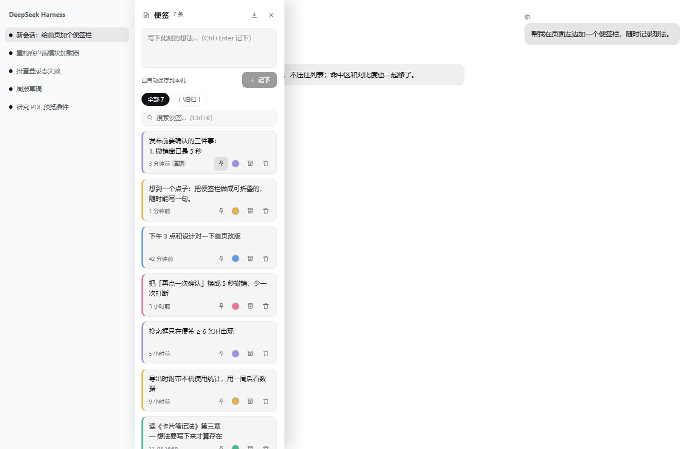
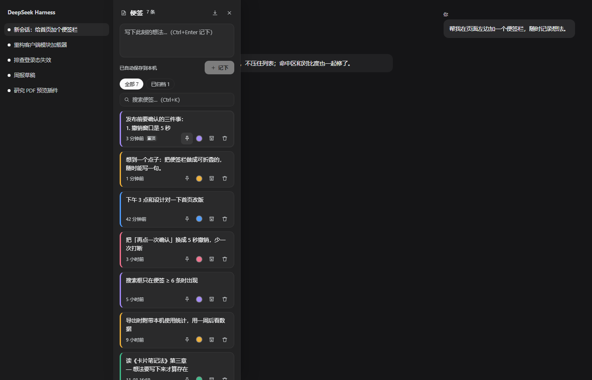
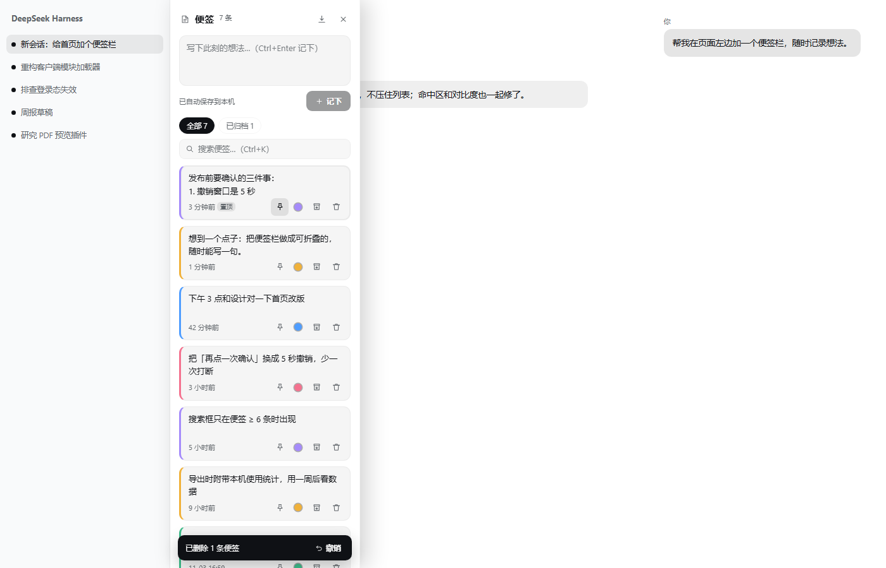
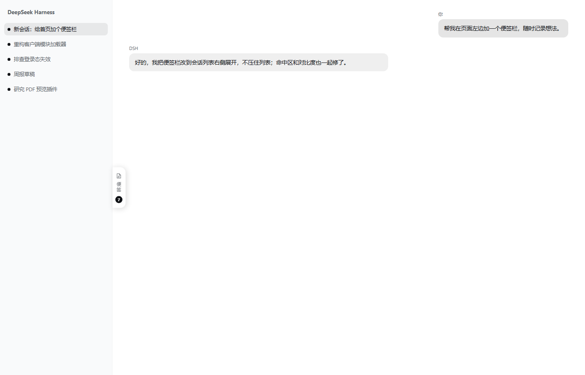

# dsh-sticky-notes

DSH（DeepSeek Harness）Web 界面**左侧的便签栏**：随时把想法记在页面边上，不打断对话。

- 贴在会话列表右边缘，**不遮挡会话列表**，没有全屏遮罩。
- 就地编辑、置顶、**按重要程度标色**、拖动排序、搜索（含归档、命中高亮、**`#标签` 筛选**、**按档位筛**）、按会话查看、备份恢复、5 秒撤销。
- 别的会话里写的便签带**来源标签**，点一下跳回那个会话。
- 打开面板时列表上方会浮一条**旧便签**（一行高，点开可读全文，关掉今天不再打扰）。
- 数据只存**本机浏览器 localStorage**：不经 Host、不上报、不发网络请求。
- 快捷键 `Alt + Shift + N` 随时开关，**展开后光标直接落在输入框里**（唤起即写）。
- 收起成贴边标签时也会提示**有草稿没记下**、**有几条置顶**（状态写进 `title` / `aria-label`，不只靠颜色）。

> npm 包名：`@woshiwenjunjie/dsh-sticky-notes`（`dsh-sticky-notes` 已被别的作者占用）。





删除后的撤销条：



收起时只剩贴边标签：



## 安装

```bash
# 从 npm 安装（发布后）
dsh plugin --profile web add @woshiwenjunjie/dsh-sticky-notes

# 本地开发：直接链到本目录
dsh plugin --profile web add link:<本目录绝对路径>
```

也可以在 DSH 的「设置 → 插件」里安装。安装后刷新页面即可看到左边缘的「便签」标签。

## 能力一览

| 方面 | 有什么 |
|---|---|
| 捕获 | `Ctrl/Cmd + Enter` 记下；草稿实时落盘（刷新不丢）；新便签永远在最上面；展开面板即聚焦输入框；**从剪贴板直接捕获**（面板空白处 `Ctrl+V` 一步成便签、5 秒撤销；`⋯`→「从剪贴板记下」先填草稿） |
| 编辑 | 点正文直接改；hover / 键盘聚焦出现**铅笔按钮**（点它进编辑）；编辑中卡片有描边 + 「编辑中 · Esc 取消」；**Esc 取消恢复原文**、失焦即保存；长便签编辑区放宽到视口 60% 可滚动 |
| 组织 | 置顶、**颜色 = 重要程度 5 档**（1 最要紧 / 2 要紧 / 3 一般 / 4 靠后 / 5 未排，点色点直接选）、**拖动排序**（键盘 `↑`/`↓` 等价）、归档、`⋯`→「重排：按最近改动」 |
| 检索 | 搜索结果跨全部便签（含归档）、命中片段高亮、点一下那条就切回编辑；`Ctrl/Cmd + K` 聚焦；搜 **`#标签`** 按标签筛（前缀匹配，可与关键词叠加）；搜索框左侧**按档位筛**（带各档条数，与标签是「且」） |
| 上下文 | 新便签记下所在**会话**，可切「本会话」视图（拿不到会话信息时该视图自动隐藏）；别的会话里写的便签带**来源标签**，点一下跳回那个会话 |
| 回看 | 打开面板时列表上方浮一条**旧便签**：至少两小时没动过、不在最近三条里；默认一行高，点开读全文，`×` 今天不再显示 |
| 数据 | JSON 备份可**还原**（按 id 合并、可撤销）、Markdown 导出给人看、多标签页同步（按 id 合并，不冲掉另一页正在打的字） |
| 安全网 | 删除 5 秒撤销；保存失败如实报错；非法备份只提示不动数据 |
| 可达性 | 命中区 ≥ 24px、对比度全部过 WCAG AA（含五色色条，有测试）、`Esc` 分层退出（含取消编辑）、收起后焦点归还、颜色不只靠颜色（数字 + 文字） |
| 性能 | 卡片 memo 化：打字只重渲染 1 张、记下一条也只重画新卡、30 秒心跳不重画文案没变的卡；300 条稳态 0.30ms |

## 用法

| 操作 | 方式 |
|---|---|
| 展开 / 收起 | 点左边缘的「便签」标签；`Esc`；点面板外面 |
| 全局开关 | `Alt + Shift + N`（展开后光标已在输入框） |
| 看有没有没处理的东西 | 收起后看贴边标签：右上角小圆点 = 有草稿没记下，置顶小图标 = 有便签被钉着 |
| 记下一条 | 顶部输入框，`Ctrl/Cmd + Enter` 或点「记下」 |
| 从剪贴板记一条 | 面板打开时，**焦点不在输入框**里按 `Ctrl/Cmd + V` → 直接成一条便签（带预览、5 秒撤销）；或 `⋯`→「从剪贴板记下（先进草稿）」先填进草稿，看一眼再记下 |
| 编辑 | 直接点便签正文改；hover / 键盘聚焦出现铅笔按钮，点它把焦点送进正文；编辑中 `Esc` 取消（恢复进入编辑前的原文），点别处/失焦 = 保存；长便签编辑时内部滚动 |
| 排序 | 拖卡片左边缘的把手（hover 显现）；或聚焦把手按 `↑` / `↓`；`⋯`→「重排：按最近改动」复位 |
| 复制一条便签 | 鼠标移到便签上（或键盘聚焦卡片）→ 右下角出现复制按钮 |
| 标重要程度 / 置顶 / 归档 / 删除 | 每条便签下方的一排按钮；点色点弹出 5 档色板，直接选档（色点旁的数字就是档位） |
| 按档位筛 | 搜索框左侧的色点 → 选一档（带各档条数）；可与 `#标签` / 关键词叠加 |
| 撤销删除 | 删除后 5 秒内点底部「撤销」 |
| 搜索 | 便签 ≥ 6 条时出现搜索框，`Ctrl/Cmd + K` 聚焦，`Esc` 先清搜索；`#标签` 按标签筛（打 `#想` 也能筛出 `#想法`），`#标签 关键词` 是「且」 |
| 视图切换 | 「全部 / 本会话 / 已归档」 |
| 回到原会话 | 点便签底部的**来源标签**（只在「不是当前会话写的」时出现） |
| 回看旧想法 | 列表上方的「翻到一条」：点一下展开全文、再点收起；`×` 今天不再显示 |
| 备份 / 恢复 | 右上角 `⋯` →「导出备份（JSON）」/「从备份恢复…」 |
| 导出 | 右上角导出按钮 → Markdown（文末附本机使用统计） |

## 设计取舍

- **抽屉不遮挡**：面板贴在会话列表右边界展开（量 `[data-dsh-sidebar-root]` + `ResizeObserver` 跟随拖动/折叠），
  而不是盖住左侧一列，也没有全屏压暗——记便签不该让你看不见会话。
- **删除用「5 秒撤销」而不是「点两次确认」**：确认框会打断思路，撤销不会。
- **排序是「你排的」**：拖动之后顺序固定，编辑不再把便签顶到最上面（否则一编辑就打乱手动顺序）。
  新便签永远落最上面，`⋯` 里留了按时间重排的兜底。
- **搜索阈值 6 条**：少于 6 条时列表一眼看得完，搜索框只会占地方。
- **收起态也要有存在感**：便签栏收起后只剩 32px 的标签，所以「有草稿没记下」「有几条置顶」
  都画在那个标签上（草稿点贴右上角、不占布局）。状态同时写进 `title` / `aria-label`，
  色盲和读屏用户同样拿得到——和 Notelets 用状态栏做提示是一个思路。
- **控件自研而非用 primitives 的 Button/Input**：300px 抽屉的密度不适合设置页尺度的控件。
- **标签不单独建模**：没有 `tags` 字段、没有标签面板、没有标签筛选器——正文里的 `#xxx` 就是标签，
  搜索时才解析并按正文缓存。少一个数据模型就少一次迁移，老备份原样能用；
  也符合调研里 flomo / memos 的做法：结构长在输入里，而不是长在设置里。
- **颜色就是重要程度**：1 最要紧 → 4 靠后，**5「未排」是默认档**。新便签不再随机取色，
  系统不替你排优先级——没想清楚就先落「未排」，排过了色点旁才出现数字。
  只用颜色表达意思是不合格的（WCAG 1.4.1，且浅色主题下五色最好也只到 4.96:1），
  所以数字（色点旁）+ 文字（色板、筛选菜单、`aria-label`）三处都给同一份信息；色弱用户读数字就行。
- **不迁移老便签的颜色**：0.1.17 之前的颜色是随机的，没有信息可还原，所以不做「一键归为未排」这种破坏性迁移——
  老便签保持原色、会被读成对应档位，想重排就点一下色点。宁可难看一阵，也不替你删数据。
- **调色板内联、档位筛选塞进搜索框**：都不新增常驻区域，首屏仍然只有列表。
- **从剪贴板捕获分两档**：快捷姿势（面板空白处 `Ctrl+V`）直接成便签——内容往往已经在屏幕上，
  图的就是少一步；`⋯` 菜单那档只填进草稿——它防的是「复制了密码/私钥，顺手点一下」，
  来得及看一眼再决定记不记。两种都只由用户显式动作触发：**不做后台轮询、不做全局 paste 监听**
  （否则你粘进聊天框的 API key 会被顺手抄进便签）。读取失败、空剪贴板、内容过长都有明确文案，
  长内容（>2000 字）自动退到草稿，>8000 字直接拒绝——便签不是剪藏。
- **清洗只清零宽垃圾，不改写文字**：ZWSP / BOM 清掉，但 ZWJ（U+200D）/ ZWNJ（U+200C）不动——
  它们是组合 emoji（👨‍👩‍👧）和波斯语/印地语单词里的语义连接符，删掉等于改写用户粘进来的内容。
- **重新编辑是「就地增强」，不引入阅读态 / 保存按钮**：点正文或铅笔即进编辑，失焦保存、
  `Esc` 取消恢复进入编辑前的原文；编辑态给卡片描边 + 「编辑中 · Esc 取消」，长便签编辑区放宽到
  视口 60% 并内部滚动。不把卡片改成默认只读（会多一次点击），也不做浮层大编辑器
  （300px 抽屉里定位/焦点成本高）——需要时再在这层之上叠加。
- **浅色主题五色压深一档**：原来的亮色（#f0b13a 等）压在白底卡片上只有 1.73–2.76:1，
  达不到图形元素 3:1；现在浅色主题 3.36–4.96:1，深色主题保持原来那套（5.19–7.55:1）。
  这五个值已经进 `npm run contrast` 门禁，改色忘改测试会直接红。

## 记下就不会丢

- **草稿实时落盘**：还没按「记下」的内容存在 `dsh-sticky-notes:draft`，刷新页面、重装插件、
  手滑关页面回来还在；按「记下」后立即清掉。
- **保存失败如实说**：localStorage 写不进去（满了 / 被禁用）时提示变红「保存失败，请先导出」，
  恢复可写后自动回到「已保存」——不会给你一个假的「已保存」。
- **中文输入法安全**：组词选字时按回车不会被当成「记下」；组词中按 `Esc` 取消候选也不会收面板。
- **多标签页同步**：内容与开合状态分两个 key 存，两个标签页同时开着不会互相覆盖。
  内容冲突**按 id 合并**而不是整份覆盖：这一页还没落盘的编辑保留、另一页的修改与新增收进来、
  另一页删掉的跟着删，这一页刚删掉的不会被另一页的快照复活（代价是同一 id 两边同时改时后落盘的赢）。

## 找得回

- **搜索跨视图**：有关键词就搜全部（含已归档），命中的归档便签带「已归档」标记、保持只读；
  此时过滤标签同步高亮「全部」，语义不打架。
- **命中高亮**：`<textarea>` 里画不出 `<mark>`，所以搜索态正文切成「只读 + 高亮」渲染；
  **点一下那条**就只把这一条切回 `textarea` 并自动聚焦，其余仍只读，搜索词不变。
- **本会话视图**：新便签记下它是在哪个会话里写的，切会话时该视图自动跟着变。
- **来源可点**：别的会话里写的便签，底部会显示那个会话的标题；`3 天前想到的这条路是谁提的` ——
  点一下直接跳回原会话看上下文。会话标题查不到（会话已删）时显示「其他会话」。
- **标签就是正文**：写 `#想法` 就是给它打标签，搜索框敲 `#想法` 只剩这一类。
  **前缀匹配**（`#想` → `#想法`），和关键词叠加是「且」（`#想法 待办`）。
  没有标签表，所以不用维护、不用迁移，老备份原样能用。

## 回看

便签真正的失败不是「记不下来」，是「记下来再也没看过」。所以每次打开面板会浮一条旧便签：

- **怎么挑**：非归档、非置顶、有正文、**至少两小时没动过**，且不在这三条最新里；
  优先避开上一次选过的那条。当天只挑一次，所以你边打字它不会一直换人。
- **多占地方**：默认一行高（约 30px）+ 省略号，展开是主动动作（点一下），展开后正文最多 120px 自带滚动。
  搜索态和归档视图里它不出现——那时列表本身才是焦点。
- **怎么关**：右端 `×`，今天不再出现；明天打开重新挑一条。状态只存一个 key
  （`dsh-sticky-notes:review`），**不进便签数据、不进备份**。
- 没有合适的旧便签、或挑中的那条被你删了，就干脆什么都不显示——不硬凑一条来打扰你。

## 备份与恢复

数据只在你这台浏览器的 localStorage 里，所以**备份是唯一的安全网**：

| 动作 | 产物 | 用途 |
|---|---|---|
| 导出 | `sticky-notes-日期.md` | 给人读、贴到别处 |
| 导出备份 | `sticky-notes-日期.json` | **可还原**：id / 颜色 / 置顶 / 归档 / 会话 / 顺序 / 时间戳全保留 |
| 从备份恢复 | — | 按 `id` 合并：同 id 取 `updatedAt` 较新的，新 id 追加，提示「已导入 N 条 · 更新 M 条」 |

- 导入后 5 秒内可撤销（整份换回导入前）。
- 认不出文件或备份里没有便签时只提示，**一个字节都不动**现有数据。
- 老便签没有会话 / 顺序字段：读取时按 `-updatedAt` 兜底，等价于以前「最近改动在前」，不强制迁移。

## 键盘与可达性

| 项 | 值 / 做法 |
|---|---|
| 全局开关 | `Alt + Shift + N`（键盘唤起后光标已落进草稿框，不用再点） |
| 记下 | `Ctrl/Cmd + Enter`（输入法组词中不触发） |
| 搜索 | `Ctrl/Cmd + K` 聚焦；`Esc` 先清搜索 |
| 标档位 | 色点（`Tab` 可达）→ 色板里 `Tab` 选档 → `Enter` 落定；`Esc` 收起色板但不收面板 |
| 按档位筛 | 搜索框左侧色点 → `Tab` 选「全部 / 某一档」 |
| 退出层级 | `Esc`：先关菜单 → 再关色板 → 再关颜色菜单 → 再退出编辑（恢复原文）→ 再清搜索词 → 再清颜色筛选 → 最后收面板 |
| 焦点 | 展开后焦点落到草稿框；收起后回到左边缘的「便签」标签；点面板外面收起时不抢焦点 |
| 排序 | 把手聚焦后 `↑` / `↓` 移动一格 |
| 命中区 | 换色 24×24、删除 28×28、头部/卡片图标 32×32（WCAG 2.2 AA 底线 24px） |
| 对比度 | 全部走 DSH 主题 token，`npm run contrast` 用真实 token 值算 WCAG 比值（见下表） |

实测对比度（`npm run contrast` 的输出）：

| 用例 | 浅色 | 深色 |
|---|---|---|
| 正文 / 面板底 | 18.90 ✓ | 15.03 ✓ |
| 次要文字（时间、提示）/ 面板底 | 5.80 ✓ | 10.42 ✓ |
| 品牌底色上的文字（按钮、提示条） | 18.90 ✓ | 15.03 ✓ |
| 错误提示文字 / 面板底 | 18.90 ✓ | 15.03 ✓ |
| 错误色边框 / 保存失败圆点 | 4.50 ✓ | 4.77 ✓ |
| 搜索高亮片段文字 / 高亮底色 | 13.39 ✓ | 10.08 ✓ |

## 数据存在哪

全部存在**本机浏览器 localStorage**，不经 Host、不上传、不发网络请求：

| key | 内容 |
|---|---|
| `dsh-sticky-notes:v1` | 便签列表（含置顶 / 归档 / 会话 / 手动顺序字段，多标签页之间同步） |
| `dsh-sticky-notes:open` | 面板开合状态（只属于当前页） |
| `dsh-sticky-notes:draft` | 还没按「记下」的草稿（记下后立即清掉） |
| `dsh-sticky-notes:metrics:v1` | 本机埋点计数（导出 Markdown 时附在末尾） |

换浏览器或清站点数据会丢，重要内容请用 `⋯` →「导出备份（JSON）」留一份可还原的备份。
注意 localStorage 按 origin 隔离：`127.0.0.1:43129` 和 `localhost:43129` 是两个 origin，便签不互通。

## 实现要点

- 宿主半侧 `lib/index.js` 是空插件，只保证 `cordis.patch.yml` 里的 entry 能加载。
- 浏览器半侧 `lib/client.js` 是普通脚本：`window.__ModuleLoader__.load({ id, factory })`，
  由 `factory(require)` 返回 Cordis 插件模块 `{ name, inject, apply }`。
- `apply` 里用 `ctx.slots.inject('shell.overlay', ...)` 注册一个覆盖在所有列之上的浮动层，
  所以它不会改动 DSH 自己的布局和滚动容器；slot 送来的标准 kit props 会被原样转发给主组件
  （「当前会话」就是从里面的 `useSessions` 读的）。
- 卡片是 `memo(NoteCard)`：`t` / `timeText` / 回调都用字符串或 `useMemo` / `useCallback` 稳住引用，
  否则浅比较永远失败、memo 形同虚设。相对时间传的是算好的字符串而不是 `tick`：
  30 秒心跳到点时，只有时间文案真的变了的那几张卡会重渲染。
- 拖动排序只记一个 ref、直接改 DOM class，**松手才提交一次顺序**，拖动过程零重渲染。
- 组件外包了一层错误边界：便签栏自身渲染失败时只隐藏它，不影响 DSH 界面。
- 更多 DSH 插件机制的细节见仓库的 [docs/plugin-authoring.md](../../docs/plugin-authoring.md)。

## 兼容性

只在 **DSH `0.2.1-rc.2`**（桌面端 0.12.1）实测通过。`package.json` 里的
`dsh.compatibility.dshReleases` 只声明实测过的版本；换版本请先跑 `npm test`。

## 开发

```bash
npm test         # smoke（加载与注册）+ behavior（迷你 React 驱动真实交互）
npm run contrast # 用真实主题 token 算 WCAG 对比度（缺主题包会 SKIP）
npm run perf     # 长列表重渲染成本：node test/perf.mjs <条数> <轮数> [客户端文件]
npm run preview  # 用真实组件输出生成静态预览页到 test/out/
```

四层测试都在 `node scripts/check.mjs` 里（CI 与本地同一套）：

| 测试 | 守什么 |
|---|---|
| `test/smoke.mjs` | 脚本能解析、能注册到 `shell.overlay`、首屏不抛 |
| `test/behavior.mjs` | 迷你 React（真 useState / 依赖缓存 / memo / 虚拟时钟 / 虚拟 30 秒心跳 / `storage` 事件）驱动真实交互：编辑不重排、输入法、落盘失败、搜索高亮、备份 round-trip、会话绑定、草稿、复制、拖动排序、剪贴板保真、多标签页合并、token 级渲染次数 |
| `test/contrast.mjs` | 从真实主题包解析 token，按 WCAG 算配色对比度 |
| `test/perf.mjs` | 整树渲染的元素数与耗时（可传客户端文件路径对比两个版本） |

零运行时依赖，不需要构建步骤：`lib/client.js` 就是发布产物。

## 变更记录

见 [CHANGELOG.md](CHANGELOG.md)。

## English summary

A sticky-notes side panel for the DSH (DeepSeek Harness) web UI. It docks at the right edge of the
session-list column (never covering it) and supports quick capture with a crash-proof draft, inline
editing, colors, pinning, drag-to-reorder (keyboard equivalent), search across all notes with match
highlighting, a per-session view, JSON backup/restore, a 5-second undo, and copy-to-clipboard.
Everything stays in the local browser — no Host, no network. i18n via `ctx.locale` (zh/en), icons from
DSH primitives, WCAG AA contrast verified by a test that reads the real theme tokens.
No build step, no runtime dependencies.

## License

MIT
